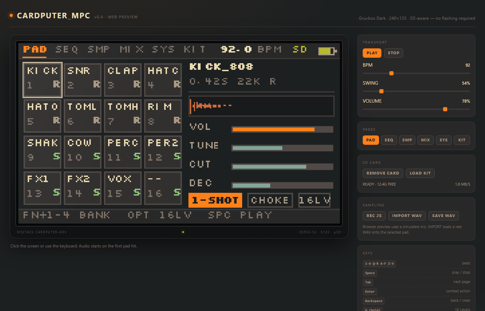

# Cardputer_MPC

M5Stack **Cardputer-Adv** 上的采样鼓机 / 步进音序器（"口袋 MPC"）。
Gruvbox Dark、240×135 像素 UI、16 垫、16 声部、8×16 步进、SD 感知。

**状态：v0.4.1-dev** — 固件可编译、Web 预览可运行；**尚未在真机上逐项验收**。
麦克风采样、采样上垫、存 SD / 从 SD 导入已经接上；流式播放、Song、BLE MIDI 还没做。



📄 **一页纸速查表**：[`docs/cheatsheet.png`](docs/cheatsheet.png) · [`docs/cheatsheet.md`](docs/cheatsheet.md)

📐 **可行性评估**：[`docs/可行性评估.md`](docs/可行性评估.md) — 硬件约束、内存预算、架构与工期

---

## 快速开始

### 1. Web 预览（不用刷机）

双击打开 **`web/index.html`**，或拖进浏览器。不需要服务器、不需要构建。

- 点屏幕或按键盘即可演奏；第一次按键/点击后音频才启动（浏览器策略）。
- 左侧是 240×135 的 1:1 画布（4× 放大、最近邻），右侧是可调 BPM / 音量 / SD / 采样面板。
- `REC 2S` 模拟录音并上垫；`IMPORT WAV` 载入真实 WAV；`SAVE WAV` 导出当前垫。
- 地址栏加 `#SEQ`、`#KIT`、`#SD`、`#NOSD`、`#LEVELS`、`#REC` 可直接打开某一屏。

### 2. 固件

```bash
cd firmware
pio run                 # 编译
pio run -t upload       # 烧写（USB-C）
```

或直接烧合并镜像（从 **0x0**）：

```bash
esptool.py --chip esp32s3 -p COMx -b 460800 write_flash 0x0 dist/CardputerMPC-8MB.bin
```

依赖：PlatformIO + `espressif32@6.9.0`；库 `M5Unified 0.3.0`、`M5GFX 0.3.0`、`M5Cardputer 1.1.1`。

---

## 实现状态

### 已经能跑

| 模块 | 状态 |
|---|---|
| 240×135 UI | 6 页（PAD/SEQ/SMP/MIX/SYS/KIT）+ SD/Loading/NoSD 三态 |
| 字体 | Silkscreen 8 px 转 1-bit 点阵（`font8.h`），与设计稿逐像素一致 |
| 音频 | I2S 44.1 kHz、ES8311、16 声部、8 种合成鼓、线性插值采样播放 |
| 音序器 | 96 PPQN、8 轨 × 16 步、播放头、力度、mute |
| 采样 | SD 挂载、套鼓扫描、16-bit PCM WAV（单/双声道、任意采样率换算）载入 128 KB 池 |
| 麦克风 | ES8311 ADC + I2S RX，最长 2 s / 22.05 kHz；录完直接上垫 |
| 存卡 / 导入 | 自动写 `/REC/REC_0001.WAV`；KIT 页 `RECORDINGS` 可把录音载回 16 个垫 |
| 演奏 | 4×4 垫、bank A–D、16 Levels（按住 Opt）、Note Repeat 预留 |
| 设置 | 音量 / BPM 存 NVS |
| 诊断 | 欠载计数、CPU、堆、SD 容量/读速、STALL |

### 还没做（v0.5+）

- 采样裁剪 / 重采样 / 自动切片（SMP 页目前只读展示）
- 流式播放（v0.4 全部采样进 RAM；大套鼓会被截断）
- 边载边弹（现在是同步载入 + 进度页）
- 慢卡自动降采样（只测速并在 SYS/SD 页显示）
- 删除套鼓 / 格式化的长按确认
- Song 模式、pattern 链、probability/ratchet
- BLE MIDI / Grove UART MIDI
- 真机验收：ES8311 录音 + 全双工、TCA8418 中断、SD 长时读稳定性

---

## 按键

| 键 | 功能 |
|---|---|
| `1-4 / Q-R / A-F / Z-V` | 触发 pad 1–16（同时选中） |
| `Space` | 播放 / 停止 |
| `Tab` | 下一页 |
| `Ent` | 上下文：PAD 开始采样（2 s）、SEQ 开关步、KIT 载入、SYS→SD、SD 测速 |
| `Bksp` | 返回 / 清除当前步 / 取消录音 |
| `Fn + ; , . /` | 方向键（SEQ 光标、KIT 选择、SMP 选垫） |
| `Fn + 1..4` | bank A–D |
| `Fn + R` | 屏幕翻转 180°（存 NVS，v0.4.1） |
| `Fn + - / =` | BPM −/+ |
| `- / =` | 音量 −/+ |
| `Opt`（按住） | 16 Levels：垫变成 1–16 级力度 |
| `Shift`（Web） | 模拟 Fn（配合 1–4 切 bank） |
| `O`（Web 按住） | 16 Levels |

---

## 麦克风采样

1. 在 PAD 页选中目标垫（点屏幕或用方向键）。
2. 按 `Ent`：ES8311 切到 ADC，I2S 从 TX 切到 RX，开始录 **最长 2 s / 22.05 kHz**。
3. 进度走完：声音自动落到该垫（`REC001`），并按 16-bit PCM WAV 写入 `/REC/REC_0001.WAV`。
4. 录音中按 `Bksp` 取消；每次录音自动编号。
5. 没有 SD 卡时采样只留在内存，重启丢失。

> 录音时 I2S 驱动会短暂卸载/重装，播放会停 ~0.2 s；v0.5 再做全双工/流式。

导入：

- `KIT` 页会出现 `RECORDINGS` 条目，`Ent` 载入后 16 个录音按文件名顺序进垫。
- 也可以把任意 16-bit WAV 拷到 `/KITS/<名字>/` 当套鼓，或拷到 `/REC/` 当录音。

---

## SD 卡

```
/REC/REC_0001.WAV         # 麦克风录音（自动存）
/KITS/<KITNAME>/*.wav     # 每个子目录一个套鼓，最多读 16 个 WAV
/KITS/*.wav               # 也支持平铺
```

- 只支持 **16-bit PCM WAV**；双声道会混成单声道；采样率任意（播放时换算）。
- 128 KB 采样池；载入套鼓时保留约 48 KB 给采样，KIT 页会标 `STR` / `MISS`。
- 没有卡时自动用内置合成鼓，并进入 `NO SD` 页；`Ent` 重试。
- v0.4 没有流式播放：`STR` 只是标记，实际仍在载入时进 RAM。

---

## 目录

```
Cardputer_MPC/
├─ firmware/            # PlatformIO 工程（ESP32-S3 / Arduino）
│  ├─ src/              # app / audio / samples / ui / font8
│  └─ partitions.csv
├─ web/                 # 免刷机预览（Canvas + WebAudio）
│  ├─ index.html        # 双击打开
│  ├─ app.js            # UI + 音序器 + 合成鼓
│  └─ font8.js          # 与固件同一套点阵
├─ design/              # 设计稿（v0.2）+ 渲染脚本
│  ├─ out/              # 10 张 240×135 设计图
│  ├─ ui-spec.md
│  └─ render_ui.py
├─ tools/gen_font.py    # Silkscreen → 1-bit 字体（固件 + Web）
├─ tools/make_cheatsheet.py
├─ tools/make_mpc_diagrams.py  # 可行性评估插图
├─ dist/                # 合并烧写镜像
└─ docs/                # README 截图 + cheatsheet + 可行性评估
```

## 重新生成资源

```bash
python tools/gen_font.py       # 字体 → firmware/src/font8.h + web/font8.js
python design/render_ui.py     # 设计稿 → design/out/*.png
python tools/make_mpc_diagrams.py  # 可行性评估插图 → docs/mpc-*.png
```

## 已知问题

- 固件未经真机验证：ES8311 初始化、I2S 时钟、TCA8418 键盘都按公开资料与先例实现，第一次上机可能需要调寄存器/引脚。
- **v0.4.1 修复显示方向**：M5GFX 0.3.0 的 Cardputer/ADV 默认 `rotation 0` 就是 240×135；v0.4.0 误设 `rotation 1` 会把坐标轴交换成 135×240，导致画面旋转/裁切。现在默认 0，`Fn+R` 可 180° 翻转并存 NVS。
- 开机 350 ms 会先在裸屏上画 `MPC / 240x135 rot=0 / FN+R = FLIP`，用来确认背光、方向和分辨率；随后才进 Loading/UI。
- 麦克风录制的寄存器序列按 ES8311 数据手册与先例写，**真机第一件事是确认 `[mpc] codec=1` 且录音不是静音**；必要时调 `0x14` PGA 和 `0x17` ADC 音量。
- 采样是 22.05 kHz 单声道、最长 2 s；采样池满时会拒绝并提示 `POOL FULL`。
- 录音时 I2S 从 TX 切到 RX 再切回，播放会停约 0.2 s；不是全双工。
- 合成鼓的噪声是每声部 xorshift，同 age 的声部会相关；听感上可接受。
- SEQ 的 swing 目前只影响 Web 预览，固件内是直拍。
- Web 预览的麦克风是模拟的；真实采样请用固件或 `IMPORT WAV`。

## 许可与致谢

MIT，见 `LICENSE`。

- 配色：[Gruvbox](https://github.com/morhetz/gruvbox)（MIT）
- 字体：[Silkscreen](https://github.com/googlefonts/silkscreen)（SIL OFL 1.1，`design/fonts/OFL.txt`）
- 硬件库：M5Unified / M5GFX / M5Cardputer（MIT）
- ES8311 初始化序列参考 [cardputer-studio](https://github.com/YONGHU-YUAN/cardputer-studio)（MIT）
