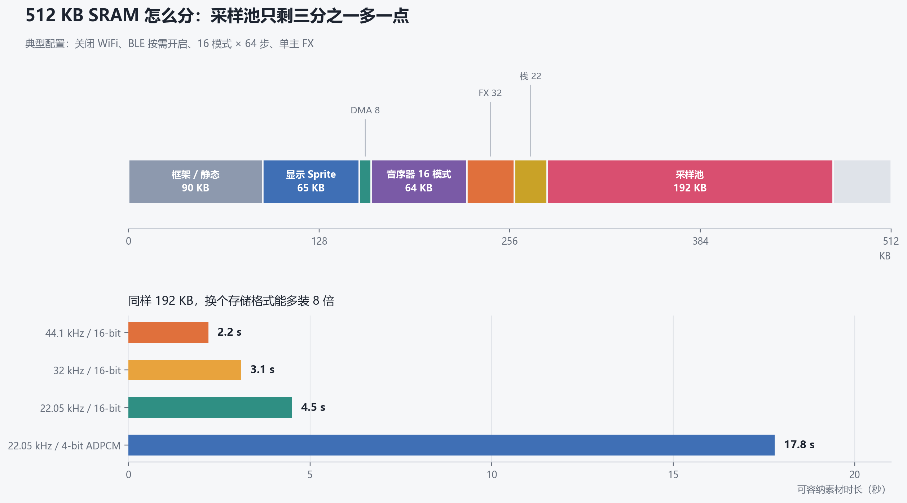
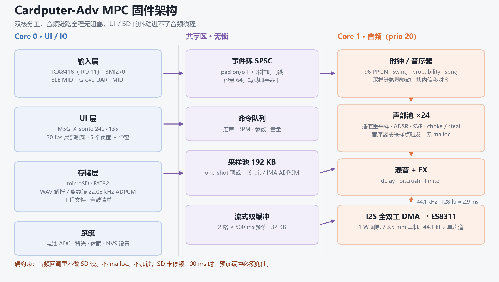
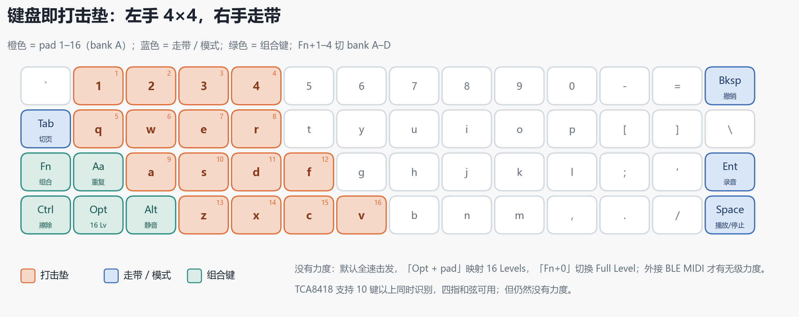
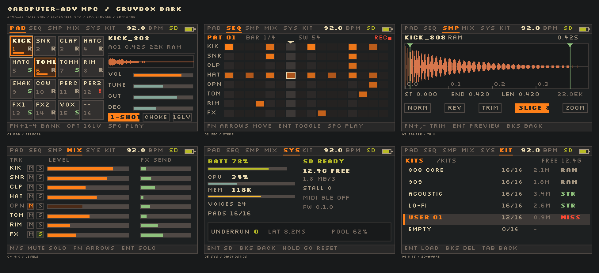

# 在 Cardputer-Adv 上做一台 MPC：可行性、难度与设计（ADV 版）

> 设备：M5Stack Cardputer-Adv，ESP32-S3FN8，512 KB SRAM / 8 MB Flash（无 PSRAM），ES8311 + 1 W，TCA8418 键盘，1750 mAh。
> 更新：2026-11-08。上一版按"原版 / Adv 双机型"评估，这一版只按你手上的 ADV 重算，并给出单目标机的设计。

---

## 0. 结论（ADV 版）

**难度从 7.5 降到 7.0。ADV 消掉了三个摩擦点——全双工录音、键盘无冲、耳机口——但没有动那三座山：512 KB 内存、SD 流式、没有力度。**

| 问题 | 回答 |
|---|---|
| 可行性 | 高。ADV 是这类项目最合适的 Cardputer 机型，Cardputer 上已有完整 groovebox 先例 |
| 难度 | **7.0 / 10**（有嵌入式音频经验）；8.5 / 10（从零开始） |
| 最大瓶颈 | 内存（无 PSRAM）> SD 流式 > 力度 > 单声道输出 |
| 目标机 | ADV 单目标，不做双机型适配；`M5.getBoard()` 那套分支可以删掉 |
| 建议定位 | 带键盘的"可编程 PO-33"，不是 MPC One 的替代品 |
| 工期 | MVP 230–330 h；可用 v1 515–840 h；打磨再 +300 h |
| 相对上一版 | 机型限制类风险消失，新增全双工 / FIFO 两类风险；工作量约 −10% |

一句话：**ADV 把"能不能边放边录""能不能四指和弦""能不能插耳机"这三个问题解决了，剩下的问题全是内存和存储的，跟机型无关。**

---

## 1. ADV 给了什么，没给什么

### 1.1 规格（单机型）

| 项目 | Cardputer-Adv |
|---|---|
| SoC | ESP32-S3FN8，2× LX7 @ 240 MHz，单精度 FPU |
| SRAM | 512 KB，**无 PSRAM** |
| Flash | 8 MB（当前工程 app 分区 3 MB，可扩到 6 MB） |
| 屏幕 | 1.14" 240×135 IPS，ST7789V2，SPI |
| 键盘 | 4×14 物理键，7×8 电气矩阵，TCA8418 @ 0x34，INT = GPIO11，10 键以上同时识别 |
| 音频 | ES8311（单声道 codec，24-bit，8–48 kHz）+ NS4150B 1 W |
| 麦克风 | 模拟 MEMS → ES8311 ADC，**可全双工** |
| 耳机 | 3.5 mm，**单声道**（ES8311 只有一个 DAC） |
| IMU | BMI270 @ 0x68（含 tap / 运动检测） |
| 电池 | 1750 mAh |
| 存储 | microSD（SPI） |
| 扩展 | Grove（G1/G2）、IR、USB-C OTG |

> 规格依据：[M5Stack Cardputer-Adv](https://openhardware.directory/devices/m5stack-cardputer-adv)、[espp BSP](https://esp-cpp.github.io/espp/dev_boards/m5stack/m5stack_cardputer.html)、[键盘技术参考](https://github.com/RetroBreeze/cardputer-keyboard-reference)。

### 1.2 四个实质提升

1. **全双工音频（ES8311 ADC + DAC）。**
   可以边放 beat 边录人声，也可以做 2–4 小节 looper。但要注意：**3.5 mm 是耳机输出口，官方规格里没有 line-in**，外部设备只能靠麦克风录（或改机接 ES8311 的 ADC 输入）。所以"采样外部合成器"仍然不方便，"录人声 / 录房间 / 内录"才是它的主场。
2. **TCA8418 + 中断。**
   按键延迟从原版 5 ms 轮询降到 **<1 ms**；10 键以上同时识别，四指和弦可用。代价是它有 10 事件的 FIFO，UI 卡顿超过几十毫秒就会丢键。
3. **3.5 mm 耳机口。**
   安静练习、录音监听、不扰民。但 ES8311 是单声道 codec，**耳机里也是单声道**，别期待声场。
4. **1750 mAh + BMI270。**
   续航比原版多约 25%；IMU 可以做"敲击力度"实验和体感控制，但只适合当彩蛋。

### 1.3 三个没变的天花板

1. **没有 PSRAM。** 512 KB 里还要塞 63 KB 的屏幕 sprite，采样池最多约 192 KB。
2. **没有力度。** 键盘就是键盘，16 Levels 是唯一现实解。
3. **单声道 1 W。** 低频下不去，混音免谈。

---

## 2. 预算：ADV 口径

### 2.1 内存



| 项目 | KB | 说明 |
|---|---:|---|
| 框架 / 静态 | 90 | IDF + Arduino + M5Unified + 任务控制块，含不可分配预留 |
| 显示 Sprite | 65 | 240×135×16bpp = 63 KiB，最大的一笔固定开销 |
| DMA / 混音 | 8 | I2S 双缓冲 + 混音临时区 |
| 音序器 | 64 | 16 pattern × 4 KB |
| FX 缓冲 | 32 | 0.5 s 单声道 delay @ 32 kHz |
| 栈 / 元数据 | 22 | audio / UI / SD 三个任务栈 + 套鼓索引 |
| **采样池** | **192** | 真正能装素材的地方 |
| 余量 / 碎片 | 39 | 别用光，heap 会碎 |
| 合计 | 512 | |

开 BLE 之后堆再少 60–80 KB，采样池掉到 110–130 KB。**ADV 的 512 KB 和原版一样，这一项没有任何改善。**

### 2.2 采样格式

| 格式 | 字节/秒 | 192 KB 可装 | 适用 |
|---|---:|---:|---|
| 44.1 kHz / 16-bit | 86.1 KiB/s | 2.2 s | 一两个旋律采样 |
| 32 kHz / 16-bit | 62.5 KiB/s | 3.1 s | 折中 |
| 22.05 kHz / 16-bit | 43.1 KiB/s | 4.5 s | 鼓组勉强 |
| 22.05 kHz / 4-bit ADPCM | 10.8 KiB/s | **17.8 s** | **推荐**：整套鼓 + 两条 loop |
| 44.1 kHz / 4-bit ADPCM | 21.5 KiB/s | 8.9 s | 旋律采样，音质优先 |

### 2.3 CPU

24 声部、44.1 kHz、每样本约 50 周期：**53 M cycles/s ≈ 单核 22%**；加 FX / memcpy / UI，峰值 35–45%。**CPU 不是瓶颈，ADV 也一样。**

### 2.4 SD 卡

- 一路 44.1 kHz / 16-bit 单声道流 = 86 KiB/s；4 路 = 344 KiB/s，SPI 带宽够
- 真问题是停顿：随机读 1–3 ms，卡内 GC 100–250 ms
- 对策：one-shot 全预载；长素材最多 2 路流、每路 500 ms 预读；套鼓打包成连续 `kit.pak`

### 2.5 延迟（ADV 口径）

| 环节 | 时间 |
|---|---|
| TCA8418 中断 → 事件入队 | 0.2–0.5 ms |
| 事件到音频线程 | 0.3–1 ms |
| 音频块 128 帧 @ 44.1 kHz | 2.9 ms |
| DMA 双缓冲 | 2.9 ms |
| ES8311 + 功放 | ~1 ms |
| **合计** | **约 7–9 ms**（256 帧则 12–15 ms） |

这是 ADV 相对原版最实在的改善之一：**同样的代码，按键到出声少了 5 ms 左右**，打鼓的手感差别很明显。

### 2.6 功耗

粗算 110–180 mA：1750 mAh 对应 9.7–16 小时理论值；实际 **7–10 小时**，满音量 + 持续读卡 + BLE 掉到 4–6 小时。

---

## 3. 设计

### 3.1 架构



- **Core 1 音频线程**（prio 20+）：I2S 回调只做 DSP，不读 SD、不 malloc、不加锁、不打印。
- **Core 0 UI 线程**（prio 5）：30 fps 脏区刷新，TCA8418 中断 → 事件队列。
- **Core 0 存储线程**（prio 3）：预载、流式预读、WAV 写盘、工程存取。
- 中间用 SPSC 无锁环：按键事件带采样时间戳，音频线程按块内偏移触发。

ADV 上可以确定的一件事：**不要用 `M5Unified` 的 `Speaker.playRaw`**。它是整段预渲染，MPC 需要连续流。自己开 I2S、双缓冲、回调混音；ES8311 用 I2C 配（两百来行），或者复用 M5Unified 的初始化后接管 I2S。

### 3.2 引脚与总线（ADV 固定接线）

| 功能 | 引脚 / 地址 | 备注 |
|---|---|---|
| 屏 ST7789 | SCLK 36 / MOSI 35 / DC 34 / CS 37 / RST 33 | SPI2，40 MHz，只写 |
| microSD | SCK 40 / MISO 39 / MOSI 14 / CS 12 | 独立引脚组，别和屏共用事务 |
| 内部 I2C | SDA 8 / SCL 9 | 400 kHz |
| TCA8418 | 0x34，INT 11 | 下降沿中断，FIFO 10 事件 |
| ES8311 | 0x18，BCLK 41 / LRCK 43 / DIN 46 / DOUT 42 | 全双工共用 BCLK/WS |
| BMI270 | 0x68 | 可选，不阻塞主线 |
| Grove | G1 / G2 | UART MIDI 或 I2S 外接 ADC |

屏和 SD 是两组独立引脚，实务上分到两个 SPI 主机——**刷屏时不能把读卡卡死**。

### 3.3 音频引擎

```
pad 事件 → 声部分配 → 取样本(池/流) → 重采样 → ADSR → SVF → 增益 → 混音 → 主 FX → limiter → I2S
```

| 参数 | 建议 | 理由 |
|---|---|---|
| 引擎采样率 | 44.1 kHz | 和素材一致 |
| 精度 | float 混音 / int16 存储 | S3 单精度 FPU 够用 |
| 声部 | 24（16 垫 + 8 尾巴） | 内存上限，CPU 只占 1/4 |
| 重采样 | 线性（鼓）/ Hermite（旋律） | ±12 半音内可接受 |
| 包络 | 32 样本块更新 | 避免逐样本 exp |
| 滤波 | TPT SVF | 稳定、便宜、无爆音 |
| 抢声 | 最旧/最轻 + 2 ms 淡出 | 防 click |
| choke | hi-hat 成对 | 后触发掐前一个 |

主 FX 只做一个 tempo-sync delay + limiter。混响的 32–48 KB 会把采样池压到 150 KB 以下。

### 3.4 采样存储：三级

| 级别 | 位置 | 容量 | 存什么 |
|---|---|---|---|
| L0 池 | SRAM | 192 KB | 当前套鼓 one-shot，16-bit 或 ADPCM |
| L1 流式 | SRAM 环形 32 KB | 2 路 × 500 ms | 长 loop、人声、backing |
| L2 库 | SD | GB 级 | 套鼓、工程、录音 |

- 预载：≤ 2 s 的采样进池，> 2 s 标流式
- 压缩：IMA ADPCM 4:1，22.05 kHz 对鼓完全够
- 目录：`/KITS/<name>/kit.pak`、`/PROJ/*.cmpc`、`/REC/*.wav`
- 格式：设备只吃 16-bit PCM WAV；其余用配套 Python 脚本离线转换

### 3.5 音序器

- 96 PPQN，16 分 = 24 tick；时钟由音频回调的采样计数驱动
- 每步 4 B：开关、力度 7 bit、长度、概率/ratchet
- swing 奇数 16 分延后 0–66%
- 16 轨 × 64 步 × 4 B = 4 KB/pattern；16 pattern = 64 KB
- song：pattern 链 + 重复次数

所有定时事件在音频线程内按"块内偏移"触发，不要用 FreeRTOS 定时器直接触发发声。

### 3.6 输入



- 左手 4×4：`1 2 3 4 / q w e r / a s d f / z x c v` = pad 1–16
- `Fn + 1..4` 切 bank A–D；`Opt + pad` = 16 Levels；`Fn + 0` = Full Level
- `Aa + pad` = Note Repeat；`Ctrl + pad` = 清除；`Alt + pad` = 静音
- 右手：`Space` 播放/停止、`Ent` 录音、`Tab` 切页、`Bksp` 撤销

ADV 的 TCA8418 让四指和弦变得可靠，这直接解锁了一个差异化功能：**Chord Mode**——一个垫触发一个调内和弦（复用 `theory.cpp`）。这在 MPC 类产品里很少见，也是"带键盘的音乐工具"最自然的卖点。

注意：TCA8418 的 10 事件 FIFO 不是无限的。UI 里任何超过 ~30 ms 的阻塞（比如整屏重绘 + 同步写 SD）都可能丢键。中断里只置标志、把读 FIFO 放到高优先级任务里做。

### 3.7 UI



6 页：PAD / SEQ / SMP / MIX / SYS / KIT，外加 SD 子页与 Loading / No-SD 两个状态页（[完整 mockup](../design/out/00-sd-states.png)）。整屏画进 63 KB sprite，只重绘脏区；全屏 30 fps 在 40 MHz SPI 下约 13 ms/帧，局部刷新才稳。

字号 8 px 一档；每屏只回答一个问题；参数编辑用 Fn + 方向键，不做多级菜单。SD 状态必须常驻顶栏，垫上标 `R/S/!`，因为"卡慢"要在声音出问题之前被看见。

### 3.8 录音、重采样、Looper（ADV 的主场）

| 工作流 | 是否需要麦克风 | 说明 |
|---|---|---|
| 内部 bounce（重采样） | 否 | 主混音直接写 WAV，最稳，建议先做 |
| 边放边录人声 | 是 | 耳机监听，避免扬声器回授 |
| Looper | 是 | 2–4 小节循环，录到 RAM 或 SD |
| 单件乐器采样 | 是 | 停止播放后录，最干净 |
| 外部合成器采样 | 是（声学） | **没有 line-in**，只能靠麦克风；要 line-in 得改机 |

**回授是 ADV 上新增的风险**：边放边录时如果走扬声器，鼓声会进麦克风。产品上要强制提示"戴耳机"，或者在检测到录音时自动把扬声器静音。

### 3.9 和现有 MusicTools 的复用

| 现有资产 | 处理 |
|---|---|
| M5GFX sprite / UI 框架、字体、布局常量 | 直接复用 |
| NVS 音量、分区表、`make_bin.ps1`、烧写流程 | 直接复用 |
| `theory.cpp` | **复用为 Chord Mode / 音阶锁定**，差异化 |
| 键盘边沿检测 | 重写：TCA8418 中断 + 时间戳 |
| `audio.cpp`（预渲染 + playRaw） | 完全重写：流式引擎 |
| 网页模拟器 | 复用 UI/音序逻辑，DSP 无法模拟 |

---

## 4. 难点与风险（ADV 版）

| # | 风险 | 概率 | 影响 | 缓解 |
|---|---|---|---|---|
| 1 | SD 流式播放爆音 / 卡顿 | 高 | 高 | 预载 + 500 ms 预读 + 最多 2 路流 + 欠载计数 |
| 2 | 内存不够，功能砍到不可用 | 高 | 高 | 22.05k ADPCM、pattern 压缩、FX 只留一个 |
| 3 | 没有力度，手感不像 MPC | 确定 | 中高 | 16 Levels / Full Level；BLE MIDI 外接 |
| 4 | 没有 line-in，外部采样只能靠麦克风 | 确定 | 中 | 定位"人声/内录"；改机或 Grove I2S ADC 是后路 |
| 5 | 边放边录时麦克风回授 | 高 | 中 | 强制耳机；录音时自动静音扬声器 |
| 6 | TCA8418 FIFO 溢出丢键 | 中 | 中 | 中断只置标志；FIFO 在高优先级任务里排空 |
| 7 | 全双工 I2S 配置翻车 | 中 | 高 | TX/RX 共用 BCLK/WS；先写 50 行双向测试 |
| 8 | 耳机单声道，预期落差 | 确定 | 低 | UI/文案明确"mono"；卖点放在便携 |
| 9 | 续航 | 中 | 中 | 背光策略、关 WiFi、停播关功放 |
| 10 | 偶发爆音难复现 | 高 | 中 | GPIO 打点 + 逻辑分析仪 + 欠载计数上屏 |

### 三个真正的硬骨头

**① SD 流式（9/10）。** 不是带宽，是尾延迟。能不流就不流：one-shot 全预载，长素材用连续 `kit.pak` 按偏移读，双缓冲 500 ms，读线程优先级高于 UI、低于音频。欠载计数器必须上屏，否则你不知道是卡了还是代码有 bug。

**② 内存（8/10）。** ADPCM 4:1（17.8 s vs 2.2 s）、pattern 位域压缩、FX 只留一个。极限时 16 pattern 降到 8，省 32 KB。别为了省 32 KB 把 sprite 换 8-bit 调色板——UI 要重写。

**③ 手感（8/10，代码解决不了）。** 16 Levels 是标准答案；IMU 做敲击力度（BMI270，100–200 Hz）延迟 10–20 ms、误触发高，只适合彩蛋。真要好手感，外接 BLE MIDI 打击垫。

---

## 5. 工作量（ADV 版）

| 模块 | 工时 |
|---|---:|
| 音频输出、时钟、全双工、欠载统计 | 35–55 |
| 声部引擎（重采样 / ADSR / SVF / choke） | 60–90 |
| 采样池 + WAV + ADPCM | 40–60 |
| SD 流式 + 预读 | 40–60 |
| 音序器 + song | 50–80 |
| 录音 / 重采样 / 裁剪 | 35–60 |
| UI 6 页 + 波形 + 步进网格 + SD 状态页 | 110–170 |
| 输入映射 / 16 Levels / repeat | 20–35 |
| 工程存取 | 25–40 |
| MIDI（BLE / UART） | 40–70 |
| 集成、爆音、功耗、文档 | 60–120 |
| **合计** | **515–840** |

| 档位 | 内容 | 工时 | 全职 | 每周 10 h |
| --- | --- | ---: | ---: | ---: |
| MVP | 16 垫 + 1 套鼓 + 16 步 + 存读（PAD/SEQ 两页） | 230–330 | 6–8 周 | 6–8 个月 |
| v1 | 加采样、FX、song、MIDI | 515–840 | 3–5 个月 | 1–1.6 年 |
| 打磨 | 稳定性、功耗、发布 | +300 | +2 个月 | +7 个月 |

参照：MusicTools 这个规模约 40–80 h；MPC 是它的 7–10 倍，70% 的难度在音频与存储。单目标机（只做 ADV）比双机型少约 10% 的工作量，主要省在测试矩阵和分支代码上。

---

## 6. 三条路线

| 路线 | 做法 | 优点 | 缺点 | 适合 |
|---|---|---|---|---|
| **A. ADV 原生**（推荐） | 就用你手上这台 | 一体化、开机即用、键盘输入方便、全双工 | 无力度、单声道、192 KB | 随身草稿机 |
| B. ADV + BLE MIDI | 加一个打击垫 | 真力度、真手感 | 两件设备、+$60–100、10–20 ms 延迟 | 认真打鼓 |
| C. 换平台 | M5 Tab5（ESP32-P4 + PSRAM）、Pi Zero 2 W、Teensy 4.1 | 内存/音质/延迟更好 | 体积、价格、启动时间、DIY | 音质优先 |

ADV 上最值得做的组合是 **A + 后续 B**：先把机器本身做出来，MIDI 留接口；不要一开始就为 B 做设计。

---

## 7. 里程碑（ADV 验收）

| 阶段 | 内容 | 验收标准 |
|---|---|---|
| M0（1 周） | I2S 44.1k 全双工、正弦 + WAV、延迟测量 | 同时录放 1 h 无欠载；按键到出声 < 10 ms |
| M1（2 周） | 16 垫 UI、套鼓预载、choke | 16 垫同时触发不爆音；换套鼓 < 2 s |
| M2（2 周） | 16 步 × 8 轨、swing、存读 | 8 轨满负荷 1 h 稳定；重启恢复 |
| M3（2 周） | 内部 bounce、麦克风录音、裁剪、分配 | 戴耳机边放边录 30 s 不丢样本；无回授 |
| M4（2 周） | delay、limiter、song chain | 切 FX 无爆音；song 循环不漂 |
| M5（2 周） | 功耗、BLE MIDI、文档 | 7 h 续航；冷启动 < 1.5 s |

**先做减法**：不做时间拉伸、不做 3 段 EQ、不做多路 aux、不做视频输出。

**下一步只做一件事**：M0 那 200 行固件，量三个数——按键到出声延迟、SD 连读 10 分钟的最大停顿、全双工 16 声部的 CPU 余量。三个数出来，功能表自然就定了。

---

## 8. 附：和原版的差异（为什么上一版的几条风险消失了）

| 维度 | 原版 | ADV | 对项目的影响 |
|---|---|---|---|
| 录音 | PDM 麦克风与扬声器共用 GPIO43，不能同时 | ES8311 全双工 | 边放边录、looper 可行 |
| 键盘 | GPIO 矩阵，约 3 键，5 ms 轮询 | TCA8418，10 键+，IRQ | 四指和弦、延迟 −5 ms |
| 耳机 | 无 | 3.5 mm（单声道） | 安静练习、录音监听 |
| 电池 | ~1400 mAh | 1750 mAh | 续航 +25% |
| 内存 | 512 KB 无 PSRAM | 同 | **没有改善** |

---

## 9. 参考

- [M5Stack Cardputer-Adv 规格](https://openhardware.directory/devices/m5stack-cardputer-adv)｜[官方文档](https://docs.m5stack.com/en/core/Cardputer-Adv)
- [espp Cardputer BSP（两代差异、音频/键盘/麦克风）](https://esp-cpp.github.io/espp/dev_boards/m5stack/m5stack_cardputer.html)
- [Cardputer 键盘技术参考（TCA8418、无冲、Fn 层）](https://github.com/RetroBreeze/cardputer-keyboard-reference)
- [cardputer-studio（ADV 引脚、ES8311、i2s 全双工实践）](https://github.com/YONGHU-YUAN/cardputer-studio)
- [cardputer-drum-machine](https://github.com/dukeko369/cardputer-drum-machine)
- [ESP32_SD_Sampler](https://github.com/copych/ESP32_SD_Sampler)
- [M5Cardputer 库](https://github.com/m5stack/M5Cardputer)

---

*图由 `../tools/make_mpc_diagrams.py` 生成。*
